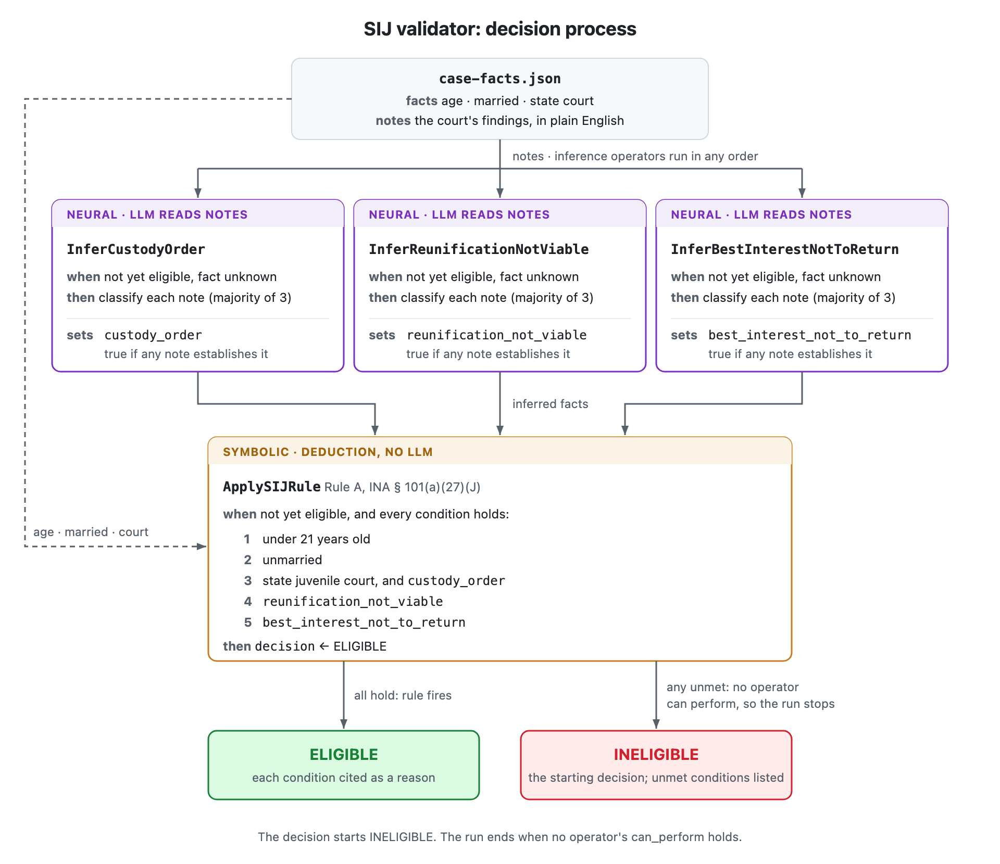

# Technical Approach

This demo validator is built with [`cognition`](https://github.com/polycog/cognition), a library for building neurosymbolic agents. It addresses the problem described in [the use case](usecase.md): checking whether an immigration case meets every statutory requirement, reliably and with reasoning that can be audited.

## Approach

The validator follows the [deductive framework of legal reasoning](https://www.judcom.nsw.gov.au/publications/benchbks/judicial_officers/argumentation_in_legal_reasoning.html#id-1.4.4.4.7) that attorneys and judges use:

1. **Major premise (the law):** the statutory requirements; here, Rule A, the SIJ criteria under INA § 101(a)(27)(J).
2. **Minor premises (the facts):** the case facts, some stated directly in the case file and some inferred from the court's notes.
3. **Conclusion:** the applicant is eligible if and only if every condition of Rule A holds.

It splits this work between two kinds of reasoning:

- **Neural: reading the text.** An LLM reads the court's notes and turns each finding into a fact (Was a custody order issued? Is reunification with a parent not viable? Is returning home not in the applicant's best interest?), citing the note each answer came from.
- **Symbolic: applying the law.** The legal rules are written as `cognition` operators, and the validator applies them to the facts by deduction. No LLM is involved in this step, so the conclusion follows from the facts exactly as the law states, and every step can be audited.

The sections below cover each part in turn: the law, the facts, and the decision process that connects them.

## The Law: Rule A

Under INA § 101(a)(27)(J), an applicant is eligible for SIJ status **if and only if**:

1. they are under 21 years old, AND
2. they are unmarried, AND
3. a state juvenile court has declared them dependent or placed them in the custody of an individual or agency, AND
4. the state court determined that reunification with one or both parents is not viable due to abuse, neglect, abandonment, or a similar basis, AND
5. the state court determined it is not in their best interest to return to their home country.

## The Facts: `case-facts.json`

```json
{
  "case": "Mateo — Special Immigrant Juvenile Status",
  "petition": "Petition for Special Immigrant Juvenile (SIJ) classification under INA § 101(a)(27)(J).",
  "facts": {
    "applicant": "Mateo",
    "age": 17,
    "married": false,
    "state_court": "California Superior Court",
    "state_court_is_juvenile_court": true
  },
  "notes": [
    "The California Superior Court legally appointed Mateo's aunt as his guardian.",
    "The court formally found that reunification with Mateo's father is impossible due to severe abandonment.",
    "The court found that returning to his home country would expose Mateo to unsafe living conditions and is not in his best interest."
  ]
}
```

The case file holds two kinds of input:

- **`facts`** holds the facts stated directly: `applicant`, `age`, `married`, `state_court`, `state_court_is_juvenile_court`.
- **`notes`** holds the court's findings in plain English. The validator infers three facts from them; see [The Decision Process](#the-decision-process).

Any of the three inferred facts (`custody_order`, `reunification_not_viable`, `best_interest_not_to_return`) can also be given directly in `facts` as `true` or `false`. The validator then treats it as known and skips the rule that would infer it.

## The Decision Process

The validator works like a careful paralegal with a checklist. It has four rules, each stating **when** it applies and **what** it does. It repeatedly picks a rule that applies and carries it out, until no rule applies.



Three fact-finding rules (neural) infer their facts from the notes; the fourth rule (symbolic) then applies Rule A to reach the conclusion. Each inferred fact starts unknown (`null`) and is set to true if some note records the finding below, or false otherwise:

| Fact | Set true when a note records… |
|---|---|
| `custody_order` | the state court appointing a guardian, placing the applicant in custody, or declaring them dependent |
| `reunification_not_viable` | a state court finding that reunification with a parent is not viable due to abuse, neglect, abandonment, or similar |
| `best_interest_not_to_return` | a state court finding that returning to the home country is not in the applicant's best interest |

> **For developers:** each rule is an `Operator` in `validator.py`, with its "when" in `can_perform` and its "what" in `perform`. The fact-finding rules (`InferCustodyOrder`, `InferReunificationNotViable`, `InferBestInterestNotToReturn`) each use a yes/no `EnumClassifier`; they can run in any order, so a `uniform_evaluator` picks among them at random. The conditions of Rule A are defined once, in `ApplySIJRule.conditions`.
